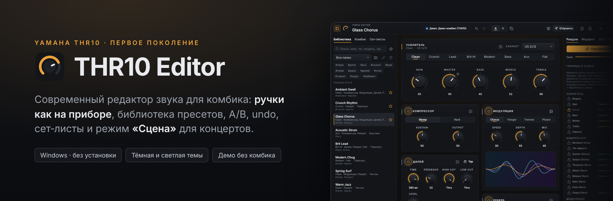
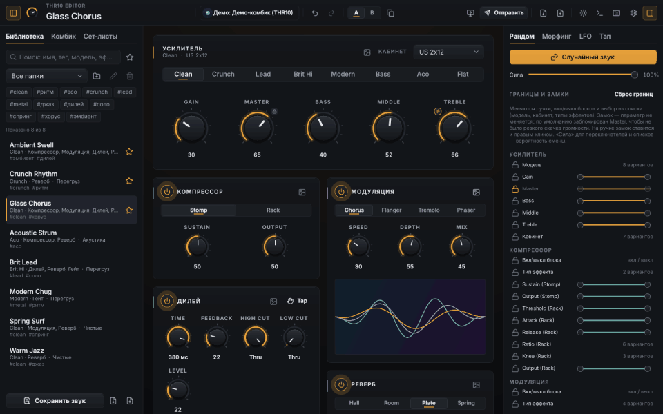
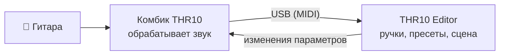
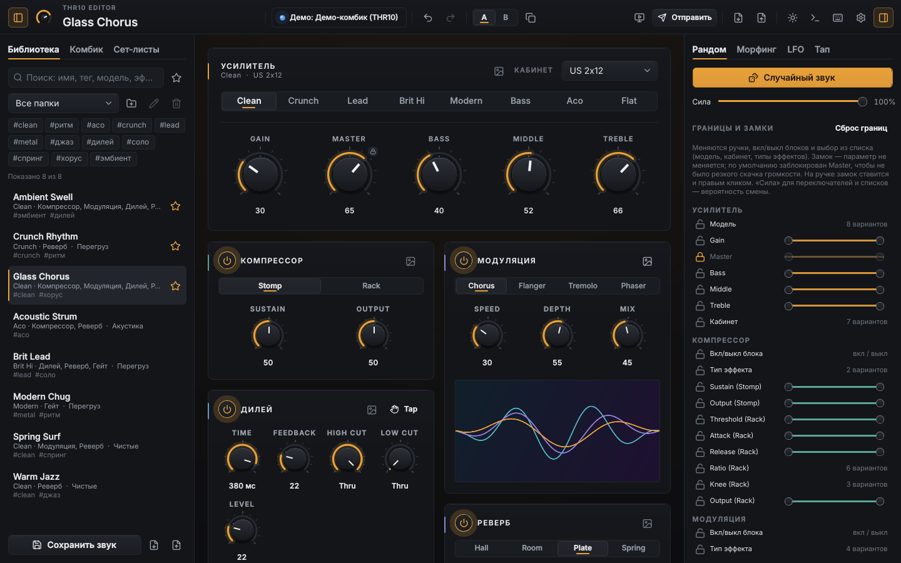
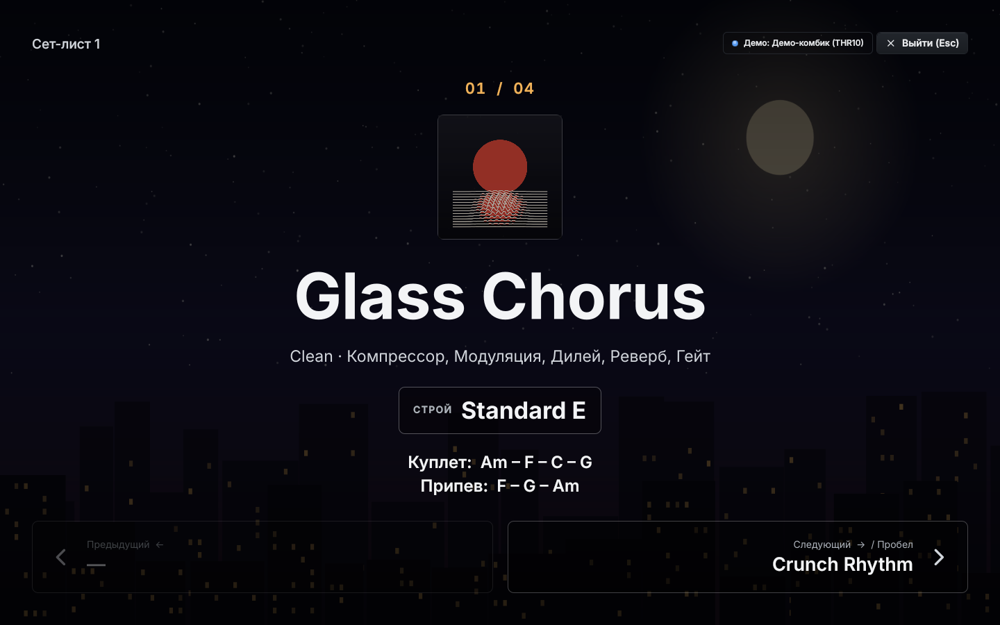
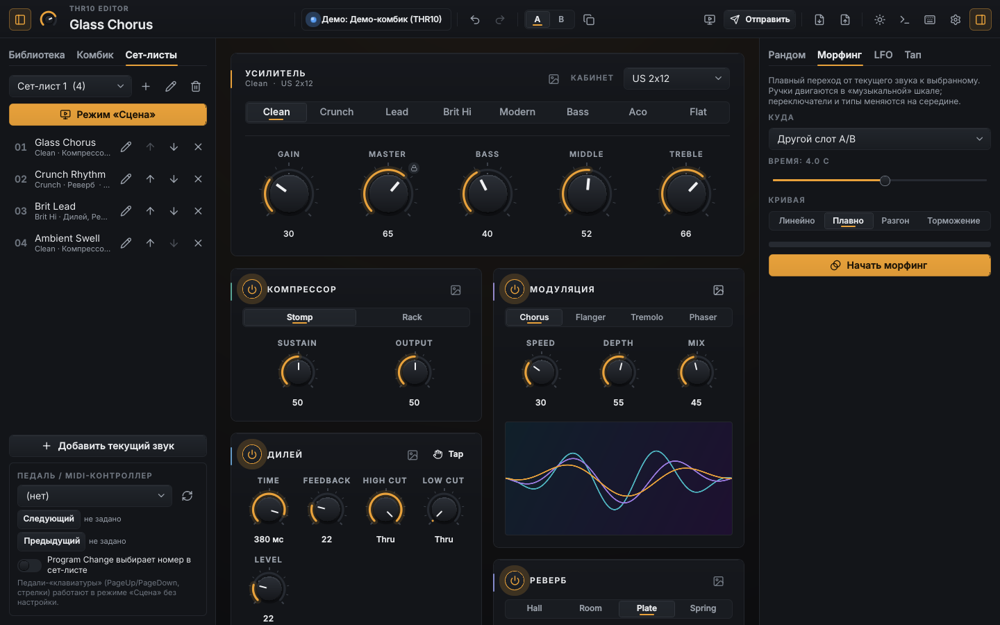
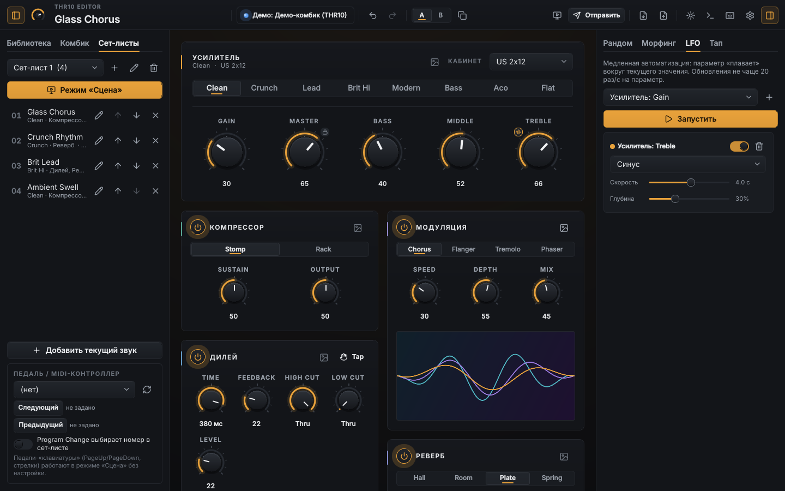
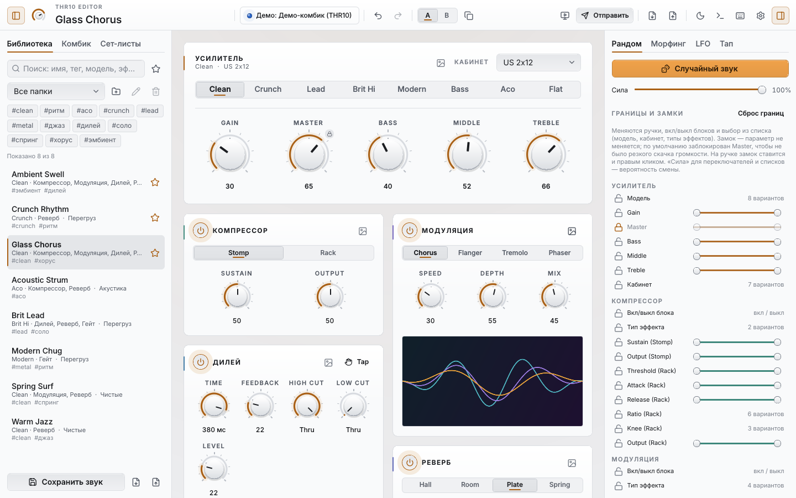

<p align="center">
  
</p>

<p align="center">
  <a href="https://github.com/timikaluzhin07-tech/thr-10-editor/releases/latest"></a>
  <a href="https://github.com/timikaluzhin07-tech/thr-10-editor/releases"></a>
  
  
  <a href="https://github.com/timikaluzhin07-tech/thr-10-editor/actions"></a>
</p>

<h3 align="center">
  <a href="https://github.com/timikaluzhin07-tech/thr-10-editor/releases/latest/download/THR10Editor.exe">⬇ Скачать для Windows</a>
  &nbsp;·&nbsp; <a href="#быстрый-старт">Быстрый старт</a>
  &nbsp;·&nbsp; <a href="#возможности">Возможности</a>
  &nbsp;·&nbsp; <a href="#вопросы">Вопросы</a>
</h3>

**THR10 Editor** — бесплатный редактор звука для гитарного комбика **Yamaha THR10
первого поколения** (а также THR10C, THR10X, THR5, THR5A). Он заменяет
официальный THR Editor: все ручки и эффекты комбика на одном экране, плюс
то, чего в оригинале нет, — библиотека без ограничений, сравнение A/B,
отмена действий, сет-листы и полноэкранный режим «Сцена» для выступлений.

Один `.exe`, установка не нужна. Нет комбика под рукой — программа
запускается в демо-режиме, можно всё посмотреть и попробовать.

<p align="center">
  
  <br><sub>Смена пресетов с плавным доворотом ручек → рандомайзер и отмена → сет-лист → режим «Сцена»</sub>
</p>

## Как это работает



1. **Подключите комбик по USB** и запустите программу — она сама найдёт
   комбик и считает его текущий звук.
2. **Крутите ручки в редакторе** — звук на комбике меняется сразу (звук
   обрабатывает сам комбик, задержки нет). И наоборот: повернули ручку на
   комбике — она повернётся в редакторе.
3. **Сохраняйте звуки в библиотеку**, собирайте сет-листы и переключайте
   пресеты на концерте с клавиатуры или MIDI-педали.

## Возможности

### Всё, что умеет официальный эдитор

* 8 моделей усилителя (Clean, Crunch, Lead, Brit Hi, Modern, Bass, Aco,
  Flat), 7 кабинетов, Gain / Master / Bass / Middle / Treble.
* Компрессор (Stomp / Rack), модуляция (Chorus / Flanger / Tremolo /
  Phaser), дилей, реверб (Hall / Room / Plate / Spring), гейт — со всеми
  параметрами.
* Двусторонняя синхронизация с комбиком и пять пользовательских ячеек
  (считать / открыть / записать).
* Импорт и экспорт библиотек официального эдитора `.YDL`, а также `.syx` и
  собственного формата `.thrpreset`.

### И то, чего в нём нет

| | |
|---|---|
| **Библиотека без ограничений** — папки, теги, поиск, избранное | **A/B-сравнение** — два звука по пробелу |
| **Undo / Redo** для любых изменений (Ctrl+Z / Ctrl+Y) | **Тап-темп** дилея клавишей T с выбором доли |
| **Рандомайзер** с границами и замками на ручках | **Морфинг** — плавный переход между звуками за N секунд |
| **LFO** — медленная автоматизация любых ручек | **Сет-листы** и режим **«Сцена»** с MIDI-педалью |
| **Строй, аккорды, фон и обложка** трека на сцене (фото или GIF) | **Своя картинка или GIF** в карточке любого модуля |
| **Тёмная и светлая темы**, масштаб интерфейса, работа без мыши | **Безопасность:** на комбик уходят только параметры звука |

## Скриншоты

<table>
  <tr>
    <td width="50%"><br><b>Главное окно.</b> Библиотека слева, усилитель и эффекты в центре, инструменты справа.</td>
    <td width="50%"><br><b>Режим «Сцена» (F5).</b> Крупно — пресет, обложка, строй и аккорды. Пробел — следующий трек.</td>
  </tr>
  <tr>
    <td><br><b>Сет-лист и морфинг.</b> Порядок треков, MIDI-педаль, плавный переход к другому звуку.</td>
    <td><br><b>LFO.</b> Ручка «плавает» сама — тремоло тембра, медленные свипы.</td>
  </tr>
  <tr>
    <td colspan="2" align="center"><br><b>Светлая тема</b> (Ctrl+Shift+L).</td>
  </tr>
</table>

## Быстрый старт

1. **[Скачайте `THR10Editor.exe`](https://github.com/timikaluzhin07-tech/thr-10-editor/releases/latest/download/THR10Editor.exe)**
   (Windows 10/11). Установка не нужна.
2. Установите драйвер **Yamaha Steinberg USB** (если ещё не стоит),
   подключите комбик по USB и включите его.
3. **Закройте официальный THR Editor** — он занимает USB-порт комбика.
4. Запустите `THR10Editor.exe`. Индикатор вверху станет зелёным:
   «Подключено». Нет комбика — включится демо-режим.

> Windows может показать «Windows защитила ваш компьютер» — программа без
> платной цифровой подписи. Нажмите **Подробнее → Выполнить в любом случае**.
> Файлы собираются автоматически из исходников этого репозитория
> ([GitHub Actions](.github/workflows/build-windows.yml)).

**Готовые пресеты** лежат в папке [`presets/`](presets/) — импортируйте
их через «Библиотека → импорт» или перетащите файл в окно.

### Главные клавиши

| Клавиши | Действие |
|---|---|
| **Пробел** | A/B: переключить звук |
| **Ctrl+Z / Ctrl+Y** | отменить / повторить |
| **Ctrl+S** | сохранить звук в библиотеку |
| **T** | тап-темп дилея |
| **F5** | режим «Сцена» (стрелки / пробел — треки, Esc — выход) |
| **F1** | все горячие клавиши |

<details>
<summary><b>Все горячие клавиши и управление ручками</b></summary>

Полный список — **F1** в программе.

| Клавиши | Действие |
|---------|----------|
| Пробел / B | A/B: переключить слот |
| Ctrl+Z / Ctrl+Y | отменить / повторить |
| T | тап-темп дилея |
| Ctrl+S | сохранить как новый пресет (перезапись — только из меню пресета, с подтверждением) |
| Ctrl+F | поиск в библиотеке |
| Ctrl+Enter | отправить звук в комбик |
| Ctrl+D | считать состояние с комбика |
| Ctrl+Shift+R | случайный звук |
| Ctrl+M / Ctrl+L | морфинг / автоматизация: старт-стоп |
| F5 | режим «Сцена»; там ← → ↑ ↓ PgUp PgDn Пробел, Esc — выход |
| Ctrl+B / Ctrl+T | боковая панель / инструменты |
| Ctrl+= / Ctrl+− / Ctrl+0 | масштаб |
| F11 | во весь экран |
| Ctrl+Shift+L | тёмная / светлая тема |

**Ручки:** перетаскивание вверх-вниз, колесо; **Shift** — точная подстройка;
**двойной клик** — значение по умолчанию; клик по числу — ввод с клавиатуры
(`350` мс, `2.5k` Гц, `thru`); правый клик — замок рандомайзера и LFO.

</details>

## Статус

Все функции работают в демо-режиме и покрыты автотестами (330+), включая
сценарии на настоящем окне программы. **На реальном комбике пока не
проверено** — у автора нет THR10. Если он есть у вас, пройдите
[короткий чек-лист](docs/HARDWARE_TEST.md) и расскажите о результате в
[Issues](https://github.com/timikaluzhin07-tech/thr-10-editor/issues).

## Вопросы

<details>
<summary><b>Не сломает ли программа мой комбик?</b></summary>

Нет. На комбик отправляются только изменения параметров звука и запрос
текущего состояния — те же команды, что шлёт официальный эдитор. Команд
прошивки и сброса в программе нет вообще, а каждое сообщение перед
отправкой проверяет защитный фильтр. Команды, назначение которых не
подтверждено (Lamp, Wide), заблокированы.
</details>

<details>
<summary><b>Нужен ли официальный THR Editor?</b></summary>

Нет. Нужен только драйвер Yamaha Steinberg USB. Официальный эдитор должен
быть закрыт, пока работает этот. Его библиотеки `.YDL` можно импортировать.
</details>

<details>
<summary><b>Какие комбики поддерживаются?</b></summary>

THR10, THR10C, THR10X, THR5, THR5A — первое поколение (с USB-B, без
Bluetooth). Серия THR-II использует другой протокол и не поддерживается.
</details>

<details>
<summary><b>Есть ли версия для macOS / Linux?</b></summary>

Готовый файл — только для Windows. Из исходников программа запускается и на
других системах (Python 3.12, `pip install -r requirements.txt`,
`python -m thr10editor`), но там не проверялась с комбиком.
</details>

<details>
<summary><b>Где хранятся мои пресеты?</b></summary>

`%APPDATA%\THR10Editor\`:

* `library.json` — библиотека и сет-листы;
* `settings.json` — настройки;
* `slots.json` — последнее известное содержимое ячеек комбика;
* `thr10editor.log` — журнал (пришлите его при ошибке);
* `protocol_overrides.json` — (создаёте вы) подтверждения команд, см.
  [docs/PROTOCOL.md](docs/PROTOCOL.md#как-подтвердить-неподтверждённое).
</details>

## Для разработчиков

<details>
<summary><b>Сборка, запуск из исходников, архитектура</b></summary>

### Запуск из исходников

```bat
py -3.12 -m venv .venv
.venv\Scripts\activate
pip install -r requirements.txt
python -m thr10editor
```

*Python 3.13+ на Windows не подойдёт: для него нет готовой сборки python-rtmidi.*

### Сборка `.exe`

```bat
scripts\build_windows.bat
```

Скрипт создаст окружение, прогонит тесты, соберёт `dist\THR10Editor.exe` и
`dist\THR10Probe.exe` и проверит собранный редактор (`--selftest`).

### Параметры командной строки

| Ключ | Что делает |
|------|-----------|
| `--demo` | сразу демо-режим без комбика |
| `--port "ИМЯ"` | подключиться к указанному MIDI-порту |
| `--no-connect` | не подключаться при запуске |
| `--light` | светлая тема |
| `--data-dir ПАПКА` | другая папка данных (например, портативный режим на флешке) |
| `--selftest СЕК` | загрузить интерфейс, поработать в демо и выйти (код 0 — всё в порядке) |
| `-v` | подробный журнал в консоль |

### Тесты и скриншоты

```bash
python -m pytest                       # все тесты (Qt — в режиме offscreen)
python -m thr10editor --demo           # запуск в демо-режиме
python tools/make_screenshots.py       # скриншоты и demo.gif для README (нужен Pillow)
```

### Как устроено

THR10 подключается по USB как MIDI-устройство. Редактор меняет параметры
комбика SysEx-сообщениями, звук обрабатывает сам комбик — дополнительной
задержки нет. На комбик уходят **только** изменения параметров, запрос
состояния и дамп пресета; каждое сообщение проверяет защитный фильтр
`SafetyGate`. Команды, не подтверждённые источниками (Lamp, Wide, запись в
ячейку), на комбик не отправляются — только в демо.

Архитектура — слоями, протокол не зависит от интерфейса:

```
thr10editor/
  protocol/   SysEx: кодирование/декодирование, таблица параметров, пресет 256 байт, .YDL/.syx
  model/      состояние звука, пресеты, библиотека, история, A/B, сет-лист,
              тап-темп, рандомайзер, морфинг, LFO (чистый Python)
  transport/  реальный MIDI (mido + python-rtmidi), демо-комбик, ограничение частоты,
              вход MIDI-педали
  app/        сессия: модель ↔ транспорт, статус связи, настройки (без Qt)
  ui/         PySide6 + QML: дизайн-токены, компоненты, экраны
tools/        thr_probe.py, parse_capture.py, генераторы иконок
tests/        pytest
docs/         протокол, дизайн, проверка на железе, перехват, ход работы
```

### Документация

* [docs/PROTOCOL.md](docs/PROTOCOL.md) — протокол THR10: команды, параметры, источники, статусы.
* [docs/DESIGN.md](docs/DESIGN.md) — дизайн-система «Studio Graphite», токены и анимации.
* [docs/HARDWARE_TEST.md](docs/HARDWARE_TEST.md) — чек-лист проверки на комбике.
* [docs/CAPTURE.md](docs/CAPTURE.md) — перехват трафика официального эдитора и разбор дампа.
* [docs/PROGRESS.md](docs/PROGRESS.md) — ход работы и принятые решения.

</details>

## Благодарности и лицензии сторонних материалов

* Протокол восстановлен по открытым работам энтузиастов:
  [SysExTones/sysex_tones](https://github.com/SysExTones/sysex_tones),
  [Mathis Rosenhauer — thrpatch](https://gist.github.com/MathisRosenhauer/25921bf9f584fb64ca124dee5c287180)
  и [THR_Footswitch](https://github.com/MathisRosenhauer/THR_Footswitch).
  Их код не копировался — использованы факты о байтах и смещениях.
* Шрифт [Inter](https://rsms.me/inter/) — SIL Open Font License 1.1
  (`thr10editor/ui/fonts/OFL.txt`).
* Иконки [Lucide](https://lucide.dev) — ISC License
  (`thr10editor/ui/qml/LUCIDE_LICENSE.txt`).

## Отказ от ответственности

Неофициальный проект, не связан с Yamaha Corporation. THR и Yamaha —
товарные знаки их владельцев. Используйте на свой риск; редактор
отправляет на комбик только изменения параметров и запросы состояния.
